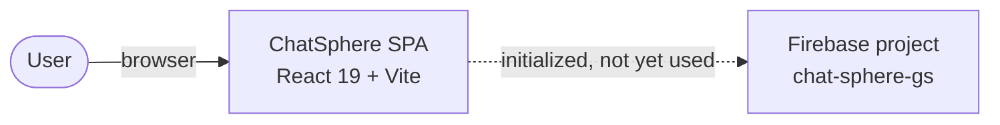
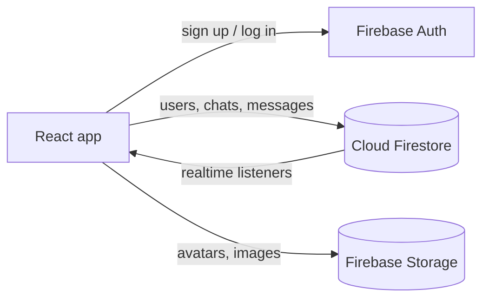

# ChatSphere: High-Level Design

A chat application front end built with React and Vite, with Firebase set up as the backend. The current code contains the complete UI (login / sign-up, three-panel chat screen and profile editor) using placeholder data; real-time messaging is the next step. Live at [chat-sphere-orcin.vercel.app](https://chat-sphere-orcin.vercel.app). For code-level detail see the [Low-Level Design](lld.md).

## 1. Context

## 2. Screens

| Route | Screen | State today |
|---|---|---|
| `/` | Login / Sign up | Form toggles between modes; not connected to auth yet |
| `/chat` | Chat: contacts sidebar, conversation, profile and media sidebar | Static sample contacts and messages |
| `/profile` | Profile update: avatar, name, bio | Avatar preview works locally |

## 3. Target architecture

## 4. Tech

| Item | Choice |
|---|---|
| UI | React 19, React Router 7 |
| Build | Vite |
| Backend | Firebase 11 SDK |
| Notifications | react-toastify |
