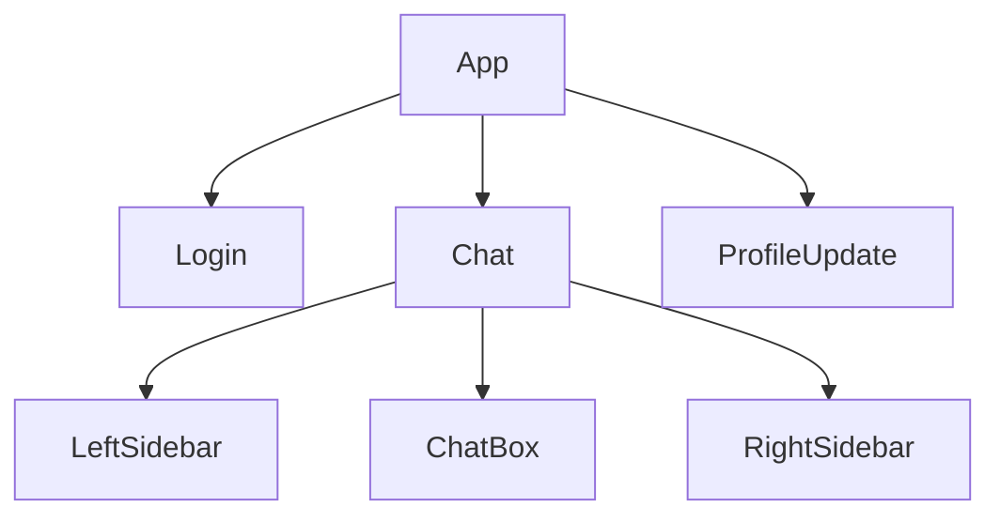

# ChatSphere: Low-Level Design

For the big picture see the [High-Level Design](hld.md).

## 1. Source layout (`chat-app/src`)

| Path | Role |
|---|---|
| `main.jsx` | Mounts `<App />` inside `BrowserRouter` |
| `App.jsx` | Routes `/` → Login, `/chat` → Chat, `/profile` → ProfileUpdate |
| `pages/Login/Login.jsx` | `currState` toggles "Sign up" / "Login"; terms checkbox |
| `pages/Chat/Chat.jsx` | Layout of `LeftSidebar`, `ChatBox`, `RightSidebar` |
| `pages/ProfileUpdate/ProfileUpdate.jsx` | Avatar picker with `URL.createObjectURL` preview, name, bio |
| `components/LeftSidebar` | Menu (Edit Profile, Logout), search box, contact list |
| `components/ChatBox` | Header, message list, input with image attach and send |
| `components/RightSidebar` | Selected user's profile, media grid, Logout |
| `config/firebase.js` | `initializeApp(firebaseConfig)` |
| `assets/assets.js` | Central export of icons and images |

## 2. Component tree

## 3. Next steps to make it real-time

| Step | Firebase API |
|---|---|
| Sign up / log in | `createUserWithEmailAndPassword`, `signInWithEmailAndPassword` |
| Store profiles | Firestore `users/{uid}` |
| Conversations | Firestore `chats/{chatId}/messages` |
| Live updates | `onSnapshot` listeners in `LeftSidebar` and `ChatBox` |
| Images | Firebase Storage upload, URL saved in the message |
